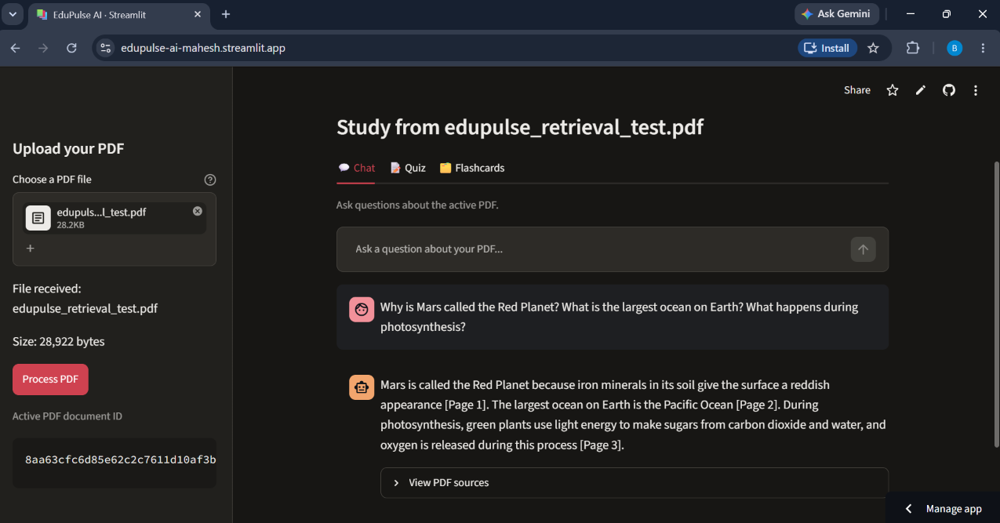
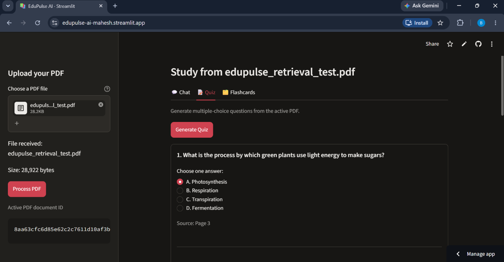
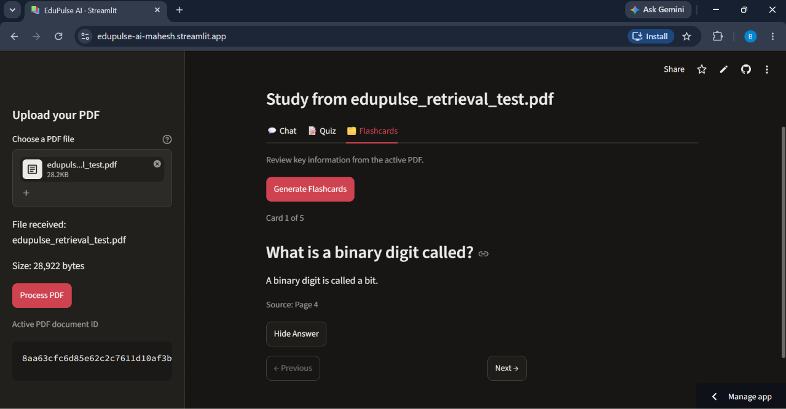
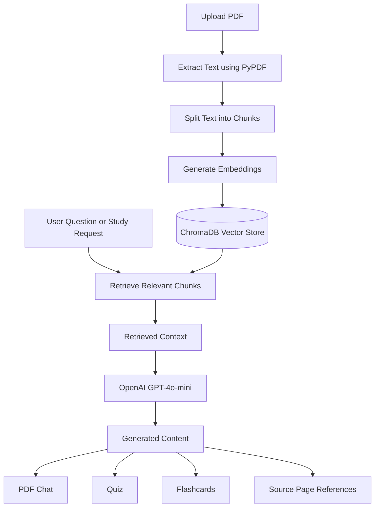

# EduPulse AI — PDF Study Assistant with RAG

EduPulse AI is an AI-powered PDF study assistant that helps students understand and revise information from their study materials. Built using **Retrieval-Augmented Generation (RAG)**, it retrieves relevant passages from uploaded PDF documents and uses AI to generate document-grounded answers, interactive quizzes, and flashcards with source-page references.

<p align="center">
  <a href="https://edupulse-ai-mahesh.streamlit.app">
    <strong>🚀 Try EduPulse AI — Live Demo</strong>
  </a>
</p>

---

## ✨ Features

- **PDF Upload and Processing:** Upload PDF documents and extract their text for studying.
- **PDF Question Answering:** Ask questions and receive AI-generated answers based on the uploaded document.
- **Semantic Retrieval:** Retrieve relevant document passages using vector embeddings.
- **Source-Page References:** Display page references so users can verify generated answers.
- **Interactive Chat:** Ask follow-up questions and keep the conversation visible while studying.
- **Quiz Generation:** Generate multiple-choice questions from retrieved PDF content.
- **Quiz Evaluation:** Check submitted answers and view scores, correct answers, and explanations.
- **Smart Flashcards:** Generate question-and-answer cards for revision.
- **Flashcard Navigation:** Reveal answers and navigate between cards using Previous and Next controls.
- **Document-Grounded Study Materials:** Generate study content using relevant information retrieved from the uploaded PDF.

---

## 🖥️ Application Screenshots

### 1. PDF Chat

Upload a PDF, ask questions, and receive AI-generated answers grounded in the document.



### 2. Quiz Generation

Generate multiple-choice questions from uploaded study materials, submit answers, and review your score.



### 3. Flashcard Generation

Generate question-and-answer flashcards to revise important concepts. Reveal answers and navigate between cards.



---

## 🛠️ Technology Stack

| Technology | Purpose |
|---|---|
| Python 3.11+ | Application development |
| Streamlit | Interactive web interface |
| ChromaDB | Vector database and similarity search |
| Sentence Transformers | Text embedding generation |
| all-MiniLM-L6-v2 | Embedding model |
| OpenAI API | AI-powered content generation |
| GPT-4o-mini | Language model |
| PyPDF | PDF text extraction |
| python-dotenv | Environment variable management |
| Pytest | Automated testing |

---

## 🏗️ Architecture

EduPulse AI follows a Retrieval-Augmented Generation architecture.

### How It Works

**1. Document Ingestion**

1. The user uploads a PDF document.
2. PyPDF extracts text from individual pages.
3. Extracted text is divided into smaller chunks.
4. Sentence Transformers converts the chunks into vector embeddings.
5. ChromaDB stores the embeddings along with metadata such as document IDs and page numbers.

**2. Retrieval and Generation**

1. The user asks a question or requests a quiz or flashcards.
2. The application retrieves relevant chunks from ChromaDB.
3. Retrieved document content is passed to the language model.
4. The language model generates a response or study material using the retrieved context.
5. Source-page references are displayed where available.

### RAG Workflow



---

## 📂 Project Structure

```text
edupulse-ai/
│
├── app.py
│
├── src/
│   ├── api/
│   ├── chunking/
│   ├── embeddings/
│   ├── ingestion/
│   ├── llm/
│   ├── prompts/
│   ├── retrieval/
│   ├── utils/
│   ├── vectordb/
│   └── rag_pipeline.py
│
├── tests/
│   ├── test_answer_generator.py
│   ├── test_loader.py
│   ├── test_rag_pipeline.py
│   ├── test_study_material_generator.py
│   └── test_vector_store.py
│
├── docs/
│   └── screenshots/
│       ├── pdf-chat.png
│       ├── quiz.png
│       └── flashcards.png
│
├── requirements.txt
├── .gitignore
└── README.md
```

---

## 🚀 Getting Started

Follow these instructions to run EduPulse AI locally.

### Prerequisites

Make sure you have:

- Python 3.11 or later
- Git
- pip
- An OpenAI API key

### 1. Clone the Repository

```bash
git clone https://github.com/mahesh001-sys/edupulse-ai.git
cd edupulse-ai
```

### 2. Create a Virtual Environment

```bash
python -m venv .venv
```

**Activate on Windows:**

```powershell
.venv\Scripts\activate
```

**Activate on macOS or Linux:**

```bash
source .venv/bin/activate
```

### 3. Install Dependencies

```bash
pip install -r requirements.txt
```

### 4. Configure the OpenAI API Key

Create a `.env` file in the project root directory.

Add your API key:

```env
OPENAI_API_KEY=your_openai_api_key
```

Replace the placeholder with your own OpenAI API key.

**Security:** Never commit your `.env` file or expose your API key in source code, screenshots, or public repositories. The `.env` file is excluded through `.gitignore`.

### 5. Run the Application

```bash
streamlit run app.py
```

Open the local URL displayed in your terminal to access EduPulse AI.

---

## ☁️ Deployment

EduPulse AI is deployed using **Streamlit Community Cloud**.

**Live Application:**  
https://edupulse-ai-mahesh.streamlit.app

### Deploy Your Own Copy

1. Push the project to a GitHub repository.
2. Open [Streamlit Community Cloud](https://share.streamlit.io/).
3. Connect your GitHub account.
4. Select your repository.
5. Set `app.py` as the main application file.
6. Open the application Secrets settings.
7. Add your OpenAI API key:

```toml
OPENAI_API_KEY = "your_openai_api_key"
```

8. Deploy the application.

Keep your API key private. Do not commit Streamlit secrets to GitHub.

---

## 💾 Storage Consideration

EduPulse AI currently uses local ChromaDB persistence to store document embeddings and associated metadata.

When deployed on Streamlit Community Cloud, local files are not guaranteed to persist across application restarts or instance replacements.

As a result, indexed documents and embeddings may need to be recreated by uploading the PDF again.

Future versions may integrate externally hosted persistent vector storage.

---

## 🧪 Testing

EduPulse AI includes automated tests using Pytest.

Run the test suite from the project root:

```bash
python -m pytest -q
```

### Latest Test Results

```text
34 passed in 22.04s
```

The test suite covers:

- PDF text extraction.
- Answer generation.
- RAG pipeline functionality.
- Quiz and flashcard generation.
- Vector store operations.

The application features were also manually verified:

- PDF upload and processing.
- Document-grounded PDF Chat.
- Quiz generation and answer evaluation.
- Flashcard generation and answer reveal.
- Previous and Next flashcard navigation.

---

## 🔮 Future Improvements

- Add persistent conversation history and multi-turn chat memory.
- Implement token-by-token streaming responses.
- Enhance flashcards with known/missed tracking and review progress.
- Support uploading and searching multiple PDFs in one knowledge base.
- Implement retrieval reranking and benchmark retrieval quality.
- Add OCR support for scanned and image-based PDFs.
- Improve error handling, input validation, and processing feedback.
- Integrate externally hosted persistent vector storage.

---

## 👨‍💻 Author

**Banoth Mahesh Kumar**

B.Tech Information Technology | 2026 Graduate

- **GitHub:** https://github.com/mahesh001-sys
- **LinkedIn:** https://www.linkedin.com/in/banoth-mahesh-kumar/

---

## 📌 Project Overview

EduPulse AI is an educational project exploring **Retrieval-Augmented Generation, semantic search, vector databases, and document-based AI applications**.

The goal is to make learning from PDF study materials more interactive, accessible, and effective through AI-powered question answering, quizzes, and flashcards.

**EduPulse AI — Learn smarter from your documents.** 📚