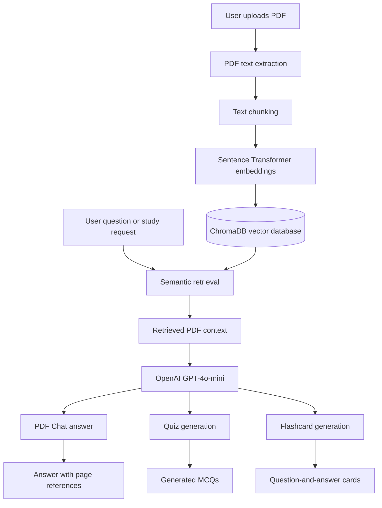

# EduPulse AI — PDF Study Assistant with RAG

EduPulse AI is an AI-powered study assistant that helps students learn from PDF documents. It uses **Retrieval-Augmented Generation (RAG)** to retrieve relevant passages and generate document-grounded answers, quizzes, and flashcards with source-page references.

<p align="center">
  <a href="https://edupulse-ai-mahesh.streamlit.app">
    <strong>🚀 Live Demo — Try EduPulse AI</strong>
  </a>
</p>

## Features

- **PDF question answering:** Ask questions about uploaded study materials.
- **Semantic retrieval:** Find relevant document passages using vector embeddings.
- **Page references:** Show source pages so users can verify information.
- **Interactive chat:** Explore PDF content through a Streamlit interface.
- **Quiz generation:** Create multiple-choice questions from retrieved PDF content.
- **Quiz scoring:** Evaluate submitted answers and display correct answers with explanations.
- **Flashcard generation:** Create question-and-answer cards for revision.
- **Document-grounded study materials:** Generate content based on retrieved text.

## Application Screenshots

### 1. PDF Chat

Upload a PDF, ask questions, and receive AI-generated answers grounded in the document.


### 2. Quiz Generation

Generate multiple-choice questions from uploaded PDF study materials.


### 3. Flashcard Generation

Generate question-and-answer flashcards to revise important concepts.


## Technology Stack

| Technology | Purpose |
|---|---|
| Python | Application development |
| Streamlit | Interactive web interface |
| ChromaDB | Vector storage and similarity search |
| Sentence Transformers | Text embedding generation |
| all-MiniLM-L6-v2 | Embedding model |
| OpenAI API | AI-powered content generation |
| GPT-4o-mini | Language model |
| PyPDF | PDF text extraction |
| Pytest | Automated testing |

## Architecture



## How It Works

### 1. Document Ingestion

1. The user uploads a PDF document.
2. PyPDF extracts text from the document.
3. Extracted text is divided into smaller chunks.
4. Sentence Transformers converts the chunks into embeddings.
5. ChromaDB stores the embeddings and associated metadata, including page numbers.

### 2. Retrieval and Generation

1. The user asks a question or requests a quiz or flashcards.
2. The application retrieves relevant chunks from ChromaDB.
3. Retrieved document content is passed to the language model.
4. The application generates a response or study material based on the retrieved context.
5. Source-page references are displayed where available.

## Project Structure

```text
edupulse-ai/
├── app.py
├── src/
│   ├── api/
│   ├── chunking/
│   ├── embeddings/
│   ├── ingestion/
│   ├── llm/
│   ├── prompts/
│   ├── retrieval/
│   ├── utils/
│   └── vectordb/
├── tests/
├── docs/
│   └── screenshots/
│       ├── pdf-chat.png
│       ├── quiz.png
│       └── flashcards.png
├── requirements.txt
├── .gitignore
└── README.md
```

## Getting Started

### Prerequisites

- Python 3.10 or later
- Git
- pip
- An OpenAI API key

### 1. Clone the Repository

```bash
git clone https://github.com/mahesh001-sys/edupulse-ai.git
cd edupulse-ai
```

### 2. Create a Virtual Environment

```bash
python -m venv .venv
```

Activate on Windows:

```bash
.venv\Scripts\activate
```

Activate on macOS or Linux:

```bash
source .venv/bin/activate
```

### 3. Install Dependencies

```bash
pip install -r requirements.txt
```

### 4. Configure the OpenAI API Key

Create a `.env` file in the project root:

```env
OPENAI_API_KEY=your_openai_api_key
```

Replace the placeholder with your own API key.

**Security:** Never commit your `.env` file or expose your API key in source code, screenshots, or public repositories.

### 5. Run the Application

```bash
streamlit run app.py
```

Open the local URL displayed in the terminal.

## Deployment

EduPulse AI is deployed using **Streamlit Community Cloud**.

**Live Application:** [🚀 Try EduPulse AI](https://edupulse-ai-mahesh.streamlit.app)

To deploy your own copy:

1. Push the project to a GitHub repository.
2. Open [Streamlit Community Cloud](https://share.streamlit.io/).
3. Connect your GitHub repository.
4. Select `app.py` as the main application file.
5. Add your OpenAI API key in the application's Secrets settings:

```toml
OPENAI_API_KEY = "your_openai_api_key"
```

6. Deploy the application.

### Storage Consideration

The application currently uses local ChromaDB persistence. Streamlit Community Cloud does not guarantee that local files will persist across restarts or instance replacements. Indexed PDFs and embeddings may need to be uploaded again after such events.

## Testing

Run the automated test suite from the project root:

```bash
python -m pytest -q
```

**Latest recorded test result: 34 passed.**

## Future Improvements

- Add persistent conversation history and multi-turn chat memory.
- Implement token-by-token streaming responses.
- Enhance flashcards with known/missed tracking and review progress.
- Support uploading and searching multiple PDFs in one knowledge base.
- Implement retrieval reranking and benchmark retrieval quality.
- Add OCR support for scanned and image-based PDFs.
- Improve error handling, input validation, and processing feedback.
- Integrate externally hosted persistent vector storage.

## Author

**Banoth Mahesh Kumar**

B.Tech Information Technology | 2026 Graduate

- [GitHub Profile](https://github.com/mahesh001-sys)
- [EduPulse AI Repository](https://github.com/mahesh001-sys/edupulse-ai)
- [LinkedIn Profile](https://www.linkedin.com/in/banoth-mahesh-kumar/)

---

*EduPulse AI is an educational project exploring Retrieval-Augmented Generation and document-based AI study tools.*